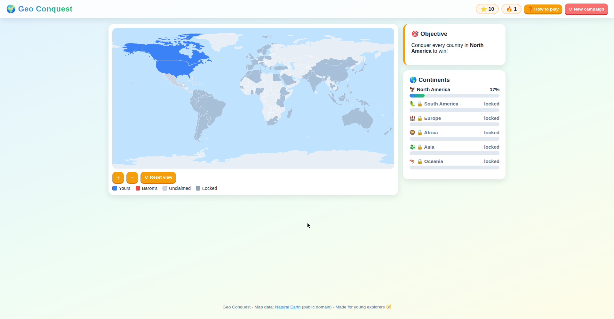

# 🌍 Geo Conquest

**Conquer the world, one geography question at a time!**

Geo Conquest is a single-player strategy-quiz game for young explorers (built with a grade‑7 geography lover in mind). Tap countries on an interactive world map, answer geography questions to conquer them, and outsmart the mischievous **Baron von Blunder** — your AI rival who steals any country you fumble!



## 🎮 How to play

1. **Pick a mode** — 🏝️ *Continent Quest* (conquer one continent to win) or 🌐 *World Conquest* (hard mode: conquer all six!).
2. **Choose your starting continent**, then tap a country to plant your flag 🚩.
3. **Tap any country** in your current continent to challenge it, pick a difficulty (😊 Easy +10 · 🤔 Medium +20 · 🧠 Hard +30), and answer the question. (😊 Easy can't break the Baron's fortresses — his countries need 🤔 Medium or 🧠 Hard!)
4. **Answer correctly** → the country is yours! **Answer wrong** → Baron von Blunder swoops in and steals it! 😈 (He also grabs an unclaimed country every few turns — stay sharp!)
5. **Conquer every country in a continent** to unlock the next one. Your mastery % per continent is tracked in the side panel.
6. Your progress **saves automatically** in the browser — close the tab and resume anytime!

Questions come in three tiers across all six continents:
- 😊 **Easy** — countries, continents, oceans
- 🤔 **Medium** — capitals, flags, famous landmarks
- 🧠 **Hard** — rivers, mountain ranges, populations, currencies

They also come in different **formats**: plain text, 🚩 flags to recognize (shown big, or as a 2×2 flag lineup to pick from), and 🗺️ "find it on the map" challenges where you tap the country on the map.

The bank holds **589 questions** (the file list lives in `data/manifest.json`, loaded from `data/questions-*.json`), preferring questions about the exact country you're attacking.

## 📄 My worksheets (play with your own questions)

Pick **📄 My worksheets** on the start screen to turn your own worksheets into a question deck, then play Continent Quest, World Conquest or Multiplayer with it. The normal game is unchanged.

1. **Add sheets**: drop or choose up to 10 files (PDF, PNG, JPG or WEBP, 5 MB each).
2. **Pick an AI helper and paste your API key**: Mistral (OCR + GLM 5.3, falls back to Mistral Large 4), Google Gemini or OpenAI.
3. **Make my deck**: each sheet is read separately ("Reading sheet 2 of 5"). If one fails, the others are kept and you can retry just the failed ones. Questions from all sheets are merged and near-duplicates removed.
4. **Save and play**: decks are saved in this browser under **My decks**, so you can replay them without new AI calls. Rename, delete, or **export/import** a deck as a `.geodeck.json` file to move it to another device.

Options: *Mix in geography questions when my deck runs out* (off by default) and *Include math questions too* (off by default). Small decks repeat their questions, shuffled. Saves and multiplayer games remember which deck they use, so **Continue** picks up with the same deck.

**Your key and privacy:** there is no backend. Files go straight from your browser to the AI company you picked. The key is kept for this browser session only, unless you tick *Remember my key on this device*. **Forget key** removes it. Keys are never stored in decks, saves or exports, and AI or imported text is always shown as plain text. A Content-Security-Policy only allows connections to the three AI providers.

**Files:** `js/ws-config.js` (models and limits), `js/ws-validate.js` (repair, merge and de-duplicate), `js/ws-providers.js` (AI calls), `js/ws-decks.js` (saved decks, export/import), `js/ws-engine.js` (deck-first question picking), `js/worksheets-ui.js` (the screen). Tests: `node tests/check.mjs` (unit tests, including `tests/ws-*.test.js`) and `node tests/e2e-ws.mjs` (browser run with a mocked provider).

## 🙏 Credits

The worksheet AI code (provider calls, Mistral reasoning-chunk handling and fallback, response validation and repair, and test fixtures) is adapted from [Worksheet Arcade](https://github.com/hanoisolo/worksheet-arcade) (`src/services`, commit 3b97026), © Don Ruan, released under the MIT License.

## 📜 License

Geo Conquest is released under the [MIT License](LICENSE), © 2026 Don Ruan.

## 🗂️ Project structure

```
geo-conquest/
├── index.html            # Page structure: screens, map, side panel, modals
├── css/style.css         # Bright, playful, mobile-friendly theme
├── js/
│   ├── app.js            # Boot: loads data, wires up all buttons
│   ├── game.js           # Game engine: state, contests, rival AI, win logic
│   ├── map.js            # SVG map renderer (equirectangular projection), zoom, clicks
│   └── storage.js        # localStorage save / load / clear
├── data/
│   ├── countries.geojson # World map: Natural Earth 110m (public domain), slimmed
│   ├── territories.json  # Playable countries per continent (68 total)
│   ├── manifest.json     # Question-file list, loaded at boot
│   └── questions-*.json  # 589-question bank (text, flags, map challenges)
├── CNAME                 # Custom domain for GitHub Pages
└── README.md
```

No frameworks, no backend, no build step — just HTML, CSS, and vanilla JavaScript.

## 🗺️ Map data & license

World boundaries come from [Natural Earth](https://www.naturalearthdata.com/) 110m admin‑0 countries (**public domain**). The vendored copy (`data/countries.geojson`) keeps only `name` / `iso3` / `continent` per country with coordinates rounded to 2 decimals (~178 KB). Two data corrections were applied to the source: France and Norway carried a placeholder `-99` ISO code and were corrected to `FRA` / `NOR`.

## ▶️ Run locally

Because the game loads its data files with `fetch()`, browsers block it when opened via `file://`. Serve the folder with any static server:

```bash
# Python 3 (simplest)
python3 -m http.server 8000

# Node.js
npx serve .
```

Then open **http://localhost:8000** 🎉

## 🚀 Deployment (GitHub Pages)

The site is deployed with GitHub Pages from the `main` branch (root folder):

1. **Enable Pages** — repo *Settings → Pages → Build and deployment*: Source = **Deploy from a branch**, Branch = **main**, folder = **/(root)**.
2. **Custom domain** — the `CNAME` file already contains `games.inguyen.ca`. In *Settings → Pages*, the custom domain field will pick it up automatically once DNS is set; then tick **Enforce HTTPS**.
3. **DNS** (at your registrar — Squarespace for `inguyen.ca`): the subdomain just needs to point at GitHub Pages:

| Type  | Host  | Points to            | TTL  |
|-------|-------|----------------------|------|
| CNAME | games | hanoisolo.github.io. | 3600 |

No A records are needed for a subdomain. (Apex/root domains would use GitHub's four A records instead.)

> ⚠️ **One domain, one repo:** GitHub Pages serves a custom domain from a single repository. If `games.inguyen.ca` is currently bound to another repo, remove the custom domain from that repo's Pages settings first, then verify it here.

## 🔮 Ideas for future versions

- Timed blitz mode & daily challenges
- Sound effects and a friendlier animated Baron
- Multiplayer "pass and play" on the same device
- More questions (oceans, deserts, and island nations deserve love too!)
- Continent-shaped jigsaw victory animations

Have fun conquering! 🧭
